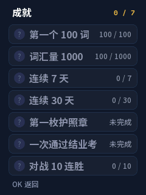

# 界面与 NABO 动画优化

PR #1 与 v0.4.0 合并后以 `0.4.1` 预发布，保留成就页、周报和对战再来一局。实机体验仍待确认，既有发布镜像和标签保持不变。

## 体验变化

- 保留原有 NABO 造型、服装和画面资源。7 套待机动画从隔帧采样的 25 帧 / 6 fps，恢复为原素材的 49 帧 / 12 fps；已有睡眠素材同步恢复原采样率。开心、难过、欢呼动作保持原采样率。
- 修复切换学段外观后沿用上一套动作帧区间的问题，并避免动画计时乘法在长时间运行后溢出。
- 主页把已学、掌握、学段进度分开排版，完成 7500 词时也能看清；顶部计数变化时给城市名称动态留出空间。
- 菜单切换增加 160 ms、最大 4 像素的收拢过渡和边框反馈；密集圆点改为细轨道与当前位置标记。
- 最小字号仍放不下的单行文字按完整 UTF-8 字符省略，避免长词、释义或菜单提示盖住相邻控件。

下图均来自生产 C 渲染器的宿主输出，属于渲染预览，不是实机照片。GIF 表示资源的播放节奏，实机帧率仍需测量。

| 主页 | 完成全部词汇 |
|---|---|
|  |  |


| 成就页 | 周报 |
|---|---|
|  |  |

## 生成与验证

需要 Python 3、Pillow、numpy，以及宿主 C 编译器。`CC` 可以是 gcc、clang、`zig cc` 或 Zig 可执行文件的路径。

```sh
# 使用 v0.3.0 Release 中经 SHA256 核验的 assets.bin，原样复用静态资源。
python3 -I firmware/tools/pack_assets.py --base-assets /path/to/v0.3.0/assets.bin
# 也可以按 firmware/README.md 用原始字体生成完整资源。
python3 tests/fw_host/test_ui.py --assets firmware/assets/assets.bin --out build/ui
python3 tests/words_host/test_words.py
python3 tests/words_host/test_extra.py
python3 tests/words_host/extra_parity.py
python3 tests/fw_host/run_host_render.py build/render
python3 tests/fw_host/run_host_battle.py
cd firmware
idf.py build
idf.py merge-bin -o nabo-words-merged.bin
python3 tools/verify_firmware.py build
```

`--base-assets` 冻结输入资源的词库、字体和静态美术，仅从仓库原始帧重新打包动画。修改过文字或静态美术时应使用 `--fonts` 完整生成。`--idle-step 2` 可显式恢复旧采样率；生成的 `nw_asset_ids.h` 与 assets 必须配套使用。

合并后的验证结果和应用 SHA256 见 [validation/v0.4.1.json](../validation/v0.4.1.json)。宿主回归覆盖 7500 词布局、7 套外观与动画跳帧解码、长时间计时、换装、菜单过渡、成就页、周报弹出和关闭，以及增量重画与整屏重画逐像素一致性。早期 `0.3.1-dev` 候选的验证记录保留在 `validation/ui-animation.json`，不能代替新镜像的验证。

渲染和两进程联机测试现在可在 Windows 和 POSIX 宿主运行；Windows 可把 `CC` 设为 Zig 可执行文件路径。Windows 的 Winsock 与等待适配只属于宿主测试，未进入 ESP32-C3 固件。

资源包为 4,658,019 字节，较 v0.3.0 增加 305,929 字节，assets 分区尚余 1,567,901 字节。词库、10 块字体和静态美术共 12 块数据与 v0.3.0 逐字节一致；动画解码缓冲的最大需求不变。

资源 SHA256：`5abc46e61f9ae1fe960d205018d0fdc6c6b6c4a382f919363db248bd0918ac6d`。

## 实机确认范围

尚未刷入工牌。需要确认实际动画节奏、实体按键与菜单过渡、连续运行与换装、睡眠唤醒、耗电表现；两台实机对战及跨天学习时钟仍未验证。宿主联机结果不能代替两台实机验收。

后续安装候选时须同时更新 app 与 assets，保留 record 分区的学习记录。NABO 美术的许可限制继续适用，见 [NOTICE.md](../NOTICE.md)。
